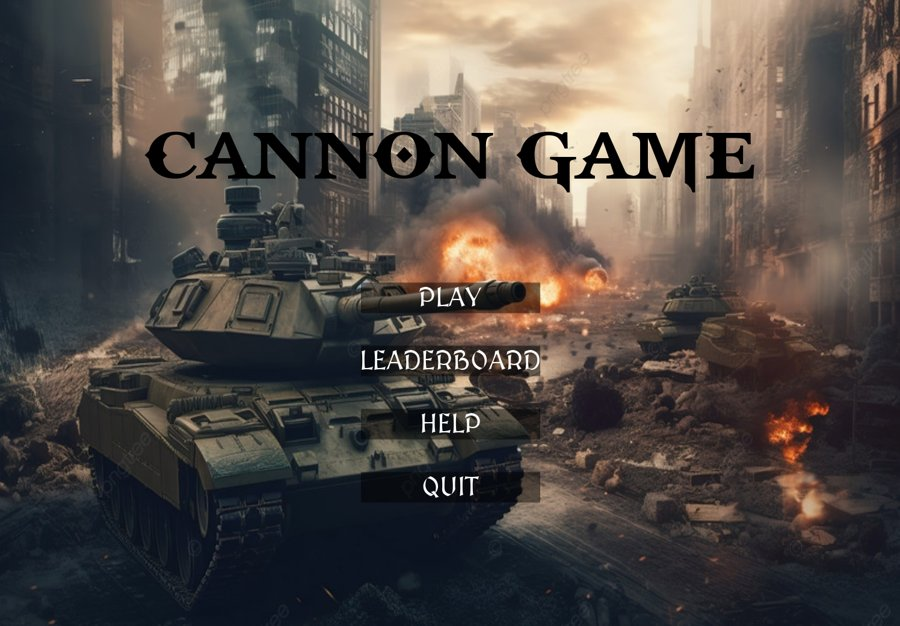
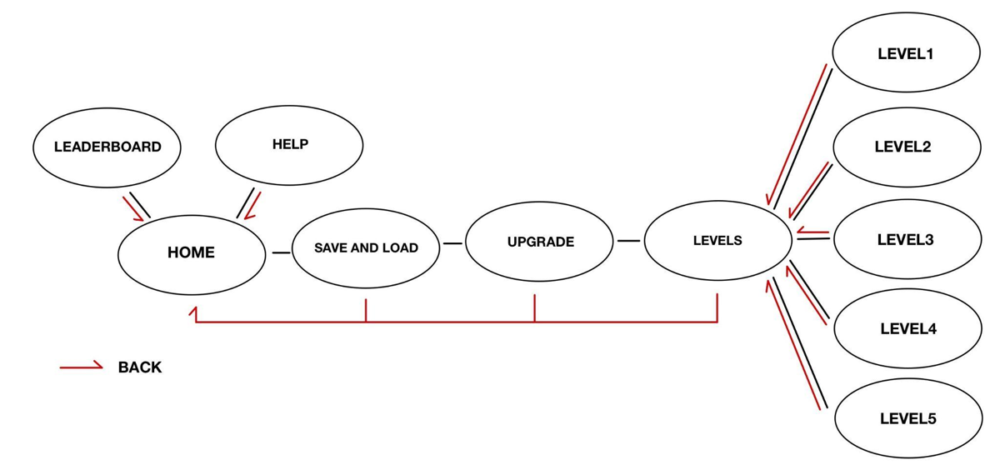

# Cannon Game: a 2D Artillery Game in Python & Kivy

<p align="center">
  
</p>

A 2D artillery game built from scratch in **Python** with the **Kivy** framework. The player commands a tank with a rotating cannon and has to clear five levels of enemies. Projectiles follow realistic gravity-based ballistics.

Final project for *Computer Programming, Algorithms and Data Structures* (BSc in Artificial Intelligence, University of Pavia, A.Y. 2023/24).

## Features

- **Physics-based shooting**: rotate the cannon and fire projectiles affected by gravity
- **Multiple weapons**: bullets, bombshells and lasers, with ammo management and ammo drops
- **5 levels** with different enemies, obstacles and a boss, plus enemy health bars
- **Upgrades**: choose your tank and cannon before each run
- **Save / load and leaderboard** stored in JSON, with player nicknames
- **Multi-screen UI** built with Kivy `ScreenManager` and `.kv` layout files

## Screen flow

<p align="center">
  
</p>

## Run it

Requires Python 3.10+.

```bash
git clone https://github.com/brusati04/kivy-cannon-game.git
cd kivy-cannon-game
pip install -r requirements.txt

cd CannonGame        # the game loads assets with relative paths
python main.py
```

## Project structure

```
CannonGame/
├── main.py              # app entry point and ScreenManager
├── main.kv, home.kv     # root and home-screen layouts
├── entities.py          # enemies, obstacles, collectables
├── projectile.py        # ballistic projectiles
├── part_tank.py         # tank and cannon parts
├── Levels/              # level selection + Level1 … Level5
├── Upgrade/             # tank/cannon selection
├── Save_and_load/       # nickname + JSON persistence
├── Leaderboard/
├── Help/
└── assets/              # images, sounds, fonts, help texts
docs/
└── report.pdf           # full project report
```

## Authors

- **Lorenzo Brusati**
- **Ecaterina Tsuhuy**

## License

Code released under the [MIT License](LICENSE). Images, sounds and fonts in `assets/` belong to their respective owners.
